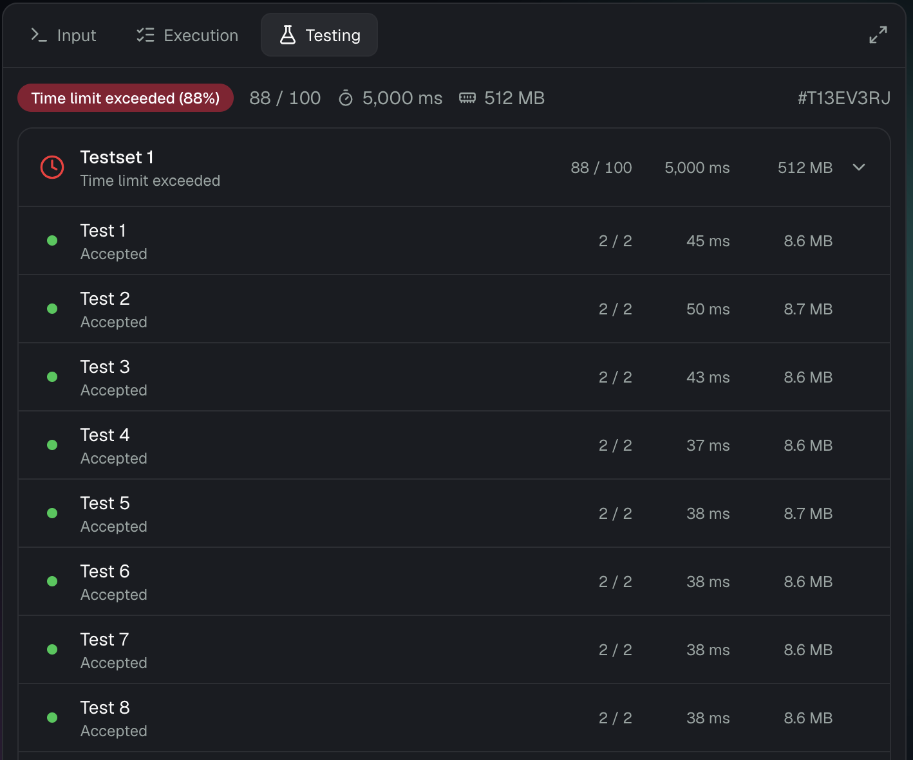

# ASPHW5

Both implementations solve the “Who Is Left?” elimination problem by simulating rounds on a list of people numbered from `1` to `n`. Each prints the number of the person who remains.

# Part 1: Functional Implementation with Haskell

## How to Run

From the repository root, run:

```sh
runghc imperative/whoisleft.hs
```

Enter a positive integer when prompted. For example, with input `10`, the program prints `3`:

```text
10
3
```

## How the Code Works

`numleft :: Int -> [Int]` takes the starting count and returns a list containing the survivor. For `n <= 0`, it returns an empty list so the program can report invalid input instead of entering the elimination loop.

For a positive `n`, `numleft` starts a local recursive function, `go`, with the list `[1..n]` and phase `0`. `go` stops when the list contains one person, as a base case.

For a recursive step it otherwise:
1. Uses `zip [1..] xs` to pair every person with their position in the current round.
2. Uses `filter (keep phase)` to save values which comply with with filter condition.
3. Uses `map snd` remap all values by ignoring their index values.
4. Advances the phase with `(phase + 1) mod 3`, cycling through phases `0`, `1`, and `2`.

`main` reads an integer from standard input and calls `numleft`. It prints the remaining number when there is one, or asks for a positive integer when the result is empty.

For input `10`, the successive lists are `[1,3,5,7,9]`, `[3,7]`, `[3,7]`, and `[3]`. The final list has one element, so `3` is printed. The solution simulates the eliminations using list operations rather than a closed-form formula.

### Why It Is Functional

The elimination logic is expressed as a recursive function that transforms a list into a new list on each round. It uses operations such as `zip`, `filter`, and `map` instead of changing a list in place or iterating with a loop. The core calculation is pure: the same input produces the same result without side effects. `main` performs console input and output, which are kept at the program boundary.

For example, `go` recursively filters the current list and advances the phase:

```haskell
go [x] _ = [x]
go xs phase =
	go (map snd (filter (keep phase) (zip [1..] xs)))
		 ((phase + 1) `mod` 3)
```

## Example Result


# Part 2: Imperative Implementation with Python

## How to Run

From the repository root, run:

```sh
python3 imperative/whoisleft.py
```

Enter a positive integer. For example, input `10` produces `3`:

```text
10
3
```

## How the Code Works

The program reads `n` and creates `arr`, containing the people numbered from `1` to `n`. It starts `phase` at `0` and repeats the elimination rounds while more than one person remains.

Each round creates an empty `arr2` and loops over the current `arr`, depending on `phase`, the loop appends that person to `arr2` if their position is odd, even, or not divisible by `3`. It then replaces `arr` with `arr2` and increments `phase`, so the three rules repeat. 

When only one person remains, the loop ends and `arr[0]` is printed. The input must be positive; with `n <= 0`, `arr` is empty and there is no remaining element to print.

### Why It Is Imperative

The Python uses fully imperative approach which compared to functional does loop over the current list, build a new list by appending retained people, replace the current list, and increment the phase. Its state changes as the program runs, especially when `arr` and `phase` are reassigned. For example, this excerpt builds the next round's list and updates that state:

```python
while len(arr) > 1:
	arr2 = []
	for i in range(len(arr)):
		curr = i + 1
		if phase % 3 == 0:
			if curr % 2 != 0:
				arr2.append(arr[i])
	arr = arr2
	phase += 1
```

## Example Result

